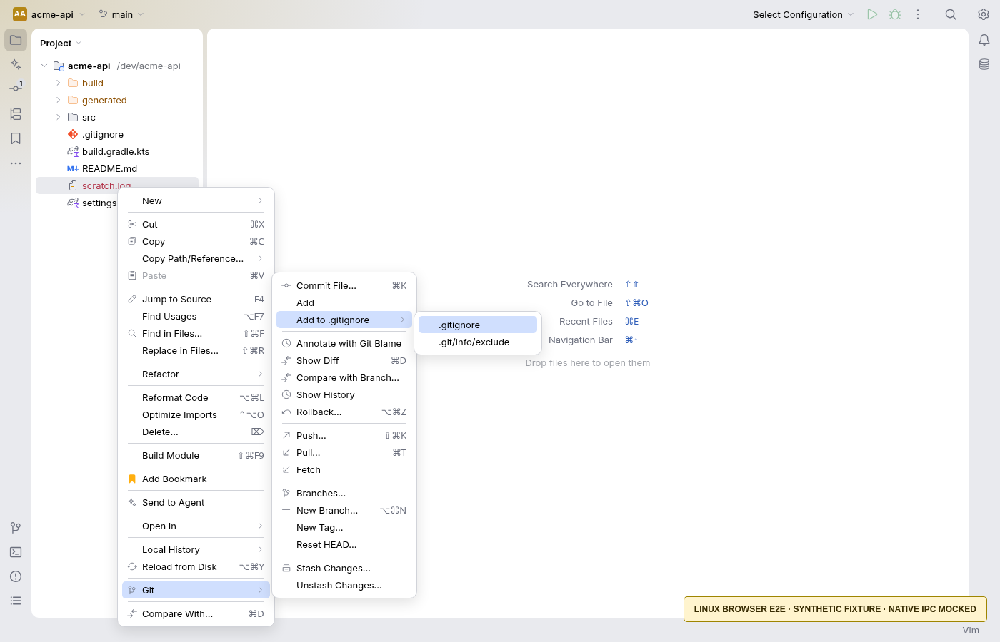
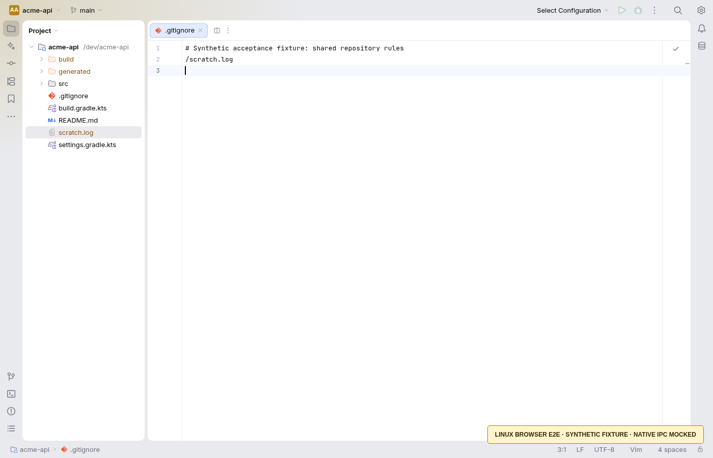
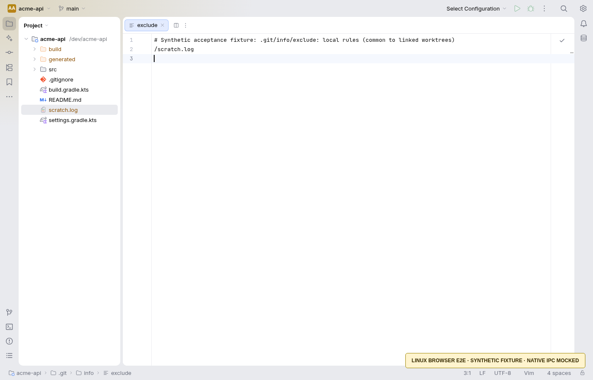

# Git › Add to .gitignore

Select unversioned files or folders in the Project view and choose **Git › Add to .gitignore**:

- **.gitignore** shares rules with the repository when you choose to commit that file. Each selected path uses its nearest existing ancestor `.gitignore`, or the owning repository's root `.gitignore` when none exists. A selected folder's own `.gitignore` cannot ignore that folder, so lookup starts at its parent.
- **.git/info/exclude** writes local repository rules. Git resolves the actual metadata path, including submodules and linked worktrees. Git's common exclude file is shared by linked worktrees of the same repository; it is not a worktree-specific setting and never becomes a tracked worktree file.

This follows [IntelliJ IDEA's documented ignore behavior](https://www.jetbrains.com/help/idea/2025.2/set-up-a-git-repository.html#ignore-files): only unversioned selections, shared versus local destinations, and Git patterns. OpenIDEA explicitly chooses the nearest existing shared file as described above. It does not implement IDEA's optional ignore-file chooser. For a different destination or wildcard pattern, edit the desired ignore file directly.

Rules are literal paths, anchored to the chosen file's base, with a trailing slash for folders. Existing rules, comments, and bytes are preserved; new lines follow the file's LF/CRLF convention. Already ignored paths are left alone. An earlier rule overridden by a later negation is appended again at the end; duplicates within the requested batch are collapsed. Spaces and Git pattern metacharacters are escaped. Newline and non-UTF-8 paths are rejected because an unambiguous rule cannot be written for them. Symlink selections, symlinked ancestors/destinations, and Git administration paths are rejected.

Tracked files (including tracked children of a selected folder) produce an explanation. The action never untracks, stages, commits, pushes, or deletes project files. **Mark Directory as › Excluded** remains a separate IDE setting; the action preserves Project view visibility options.

Each destination uses a sibling lock, a synced temporary file, a final content comparison, and atomic replacement. Failed preparation leaves the previous destination intact. A leftover lock produces an actionable error. Concurrent edits detected before replacement abort the write; as with other optimistic file saves, a non-cooperating writer racing after the last comparison cannot be excluded. Multiple destination files are independent transactions: a later failure can leave earlier files updated, and the error says to refresh and retry. The UI refreshes Git status and loaded tree folders even after a partial failure.

The command is registered on the project host and in the remote server dispatcher, so remote projects write on the remote host. Local excludes are loaded from Git's common metadata directory in the tree as well as by Git status. The action explicitly refreshes watcher ignore caches when metadata is outside a linked worktree's watched directory.

Tests run in development/CI against disposable repositories. No packaging or release workflow is changed.

## Linux acceptance screenshots

These screenshots use the actual browser-rendered menu, action dispatch, tree refresh, and editor, with a synthetic MemoryFs project and **mocked native IPC**. Their yellow banner marks that boundary. Editor rule text is supplied by the browser test; it is not evidence of a native disk read. Real disk writes and Git effects are covered separately by the Rust Git and remote RPC tests. Native desktop GUI behavior on macOS and Windows was not exercised here.

Regenerate them on Linux using `OPENIDEA_ACCEPTANCE_DIR=<output-directory> pnpm exec playwright test e2e/gitIgnore.spec.ts`. The managed environment uses its installed Chromium through a temporary Playwright configuration; that configuration is not part of this change.
